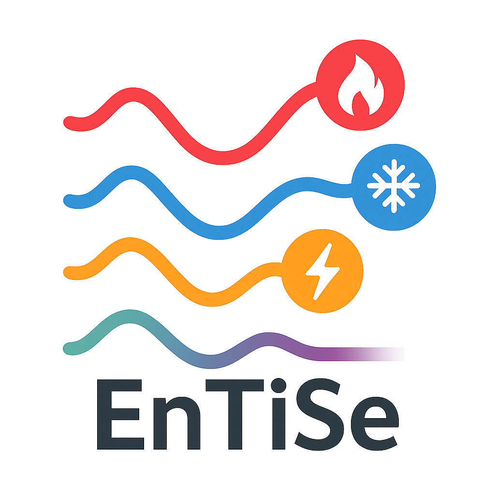

|badge_license| |badge_pypi| |badge_python| |badge_documentation|

A simple tool for generating time series data related to energy systems and building operations.

.. contents::
    :depth: 1
    :local:
    :backlinks: top

Introduction
=============
**EnTiSe** (En-ergy Ti-me Se-ries) is a Python package designed to generate realistic time series data for various energy systems and building operations.
It provides a flexible, pipeline- and strategy-based approach to create time series for different applications including HVAC, domestic hot water, electricity, mobility, and occupancy patterns.

Key Features
-------------
- Multiple time series types including DHW, HVAC, PV, and more in the works.
- Flexible pipeline- and strategy-based architecture for customizable time series generation.
- Support for dependent methods to create related time series.
- Two access patterns: batch processing via Generator or direct method imports for individual control.

Getting Started
================
To get started, follow these steps:

Requirements
-------------
- `Python <https://www.python.org/>`_ (3.11 to 3.14)
- `Git <https://git-scm.com/>`_ for version control (optional, only for development)

Installation
-------------
EnTiSe can be installed directly from PyPI:

.. code-block:: bash

   pip install entise

The default installation provides the core. Add the methods you use by
listing their extras in one command:

.. code-block:: bash

   pip install "entise[pv-pvlib,hvac-1r1c]"

Use a type group such as ``entise[hvac]`` to install all packaged methods of that
type. Use ``entise[all]`` for the previous feature coverage, ``entise[weather]``
for the weather service, or ``entise[examples]`` for plotting and notebooks.
Example scripts and notebooks also need the extras for the methods they run.
The installation guide and each method reference page list the install commands.

For faster installation, you can use `uv <https://github.com/astral-sh/uv>`_:

.. code-block:: bash

   pip install uv
   uv pip install entise

For development or the latest features, you can install directly from the repository:

.. code-block:: bash

   pip install git+https://github.com/tum-ens/entise.git

Or clone the repository and install in development mode:

.. code-block:: bash

   git clone https://github.com/tum-ens/entise.git
   cd entise
   pip install -e ".[dev]"

The examples directory contains scripts and notebooks for the available methods.

Repository Structure
=====================

- **entise/**: Main project code organized in a Python package.

  - **constants/**: Definitions of time series types and other constants.
  - **core/**: Core functionality and base classes.
  - **data/**: Data files and data handling utilities.
  - **methods/**: Implementation of various time series generation methods.
  - **services/**: Auxiliary services supporting the core functionality.
- **tests/**: Folder for tests; structured by functionality.
- **docs/**: Documentation source files.
- **examples/**: Example scripts demonstrating usage of the package.

Usage Guidelines
=================

Install the two method extras for the examples below with
``pip install "entise[hvac-1r1c,pv-pvlib]"``.

Batch Processing
----------------

Use ``Generator`` to run methods for one or more objects. This example
generates 24 hours of HVAC demand for one building using synthetic weather.

.. quickstart-batch-start

.. code-block:: python

   import pandas as pd

   from entise import Generator

   hours = pd.date_range("2025-01-01", periods=24, freq="h", tz="UTC")
   weather = pd.DataFrame(
       {
           "air_temperature[C]": 0.0,
           "relative_humidity[1]": 0.7,
           "surface_air_pressure[Pa]": 101325.0,
       },
       index=hours,
   )

   gen = Generator(raise_on_error=True)
   gen.add_objects({
       "id": "building1",
       "hvac": "1R1C",
       "weather": "weather",
       "timezone": "UTC",
       "resistance[K W-1]": 0.006,
       "capacitance[J K-1]": 1.1e7,
       "init_temperature[C]": 20.0,
       "min_temperature[C]": 20.0,
       "max_temperature[C]": 24.0,
       "gains_internal[W]": 0.0,
       "gains_solar[W]": 0.0,
   })

   summary, series = gen.generate({"weather": weather}, workers=1)
   hvac = series["building1"]["hvac"]
   print(summary)
   print(hvac.head())

.. quickstart-batch-end

Direct Method Access
--------------------

Call the method directly for a single PV system. This example uses four
hours of synthetic midday irradiance in Munich.

.. quickstart-direct-start

.. code-block:: python

   import pandas as pd

   from entise.methods.pv import PVLib

   hours = pd.date_range("2025-06-21 10:00", periods=4, freq="h", tz="UTC")
   weather = pd.DataFrame(
       {
           "global_horizontal_irradiance[W m-2]": [620.0, 660.0, 640.0, 580.0],
           "direct_normal_irradiance[W m-2]": [600.0, 630.0, 620.0, 580.0],
           "diffuse_horizontal_irradiance[W m-2]": [100.0, 100.0, 100.0, 100.0],
           "air_temperature[C]": 20.0,
           "wind_speed[m s-1]": 2.0,
       },
       index=hours,
   )

   result = PVLib().generate(
       latitude=48.1, longitude=11.6, altitude=520, power=5000,
       azimuth=180, tilt=30, weather=weather,
   )
   print(result["summary"])
   print(result["timeseries"])

.. quickstart-direct-end

See the `Getting Started guide <https://entise.readthedocs.io/en/latest/getting_started.html>`_
and the examples directory for more ways to use EnTiSe.

Supported or Planned Time Series Types
---------------------------------------
EnTiSe supports generating time series for the following types:

Integrated:

- Electricity demand
- Domestic Hot Water (DHW)
- Heat pump (COP)
- HVAC (Heating, Ventilation, and Air Conditioning)
- Occupancy data
- Solar Photovoltaic (PV)
- Wind energy

Planned:

- Concentrated Solar Power (CSP) (https://oemof-thermal.readthedocs.io/en/latest/concentrating_solar_power.html)
- Geothermal energy
- Hydroelectric power (https://github.com/IdahoLabResearch/HydroGenerate or https://github.com/9505-PNNL/wmpy_power or https://www.theoj.org/joss-papers/joss.03294/10.21105.joss.03294.pdf)
- Mobility (https://emobpy.readthedocs.io/en/latest/)
- Solar thermal (https://oemof-thermal.readthedocs.io or https://www.theoj.org/joss-papers/joss.03294/10.21105.joss.03294.pdf)
- Tidal energy
- Wave energy

Documentation
==============
Please see the `documentation <https://entise.readthedocs.io>`_ for further information.

Contribution and Code Quality
==============================
We are happy if you want to contribute to this repository! Have a look at the guides in our docs for more information on how to contribute and our coding standards.

Coding Standards
-----------------
This repository follows consistent coding styles. Refer to `CONTRIBUTING.md <./docs/guides/CONTRIBUTING.md>`_ for detailed standards.

Changelog
----------
The changelog is maintained in the `CHANGELOG.md <CHANGELOG.md>`_ file.
It lists all changes made to the repository.
Follow instructions there to document any updates.

License and Citation
=====================
EnTiSe's own code is distributed under the `MIT License <LICENSE>`_.
Independently installed dependencies and external services have their own
terms. See the `third-party licensing guide
<https://entise.readthedocs.io/en/latest/installation.html#third-party-licenses>`_
for upstream licenses and data attribution.

If you use EnTiSe in research, cite Doepfert, M., & Hamacher, T. (2026).
`EnTiSe: A Python framework for scalable synthetic energy time-series generation
<https://doi.org/10.1016/j.softx.2026.102784>`_. *SoftwareX*, 35, 102784.

.. |badge_license| image:: https://img.shields.io/badge/license-MIT-blue
    :target: LICENSE
    :alt: License

.. |badge_documentation| image:: https://img.shields.io/badge/docs-available-brightgreen
    :target: https://entise.readthedocs.io
    :alt: Documentation

.. |badge_contributing| image:: https://img.shields.io/badge/contributions-welcome-brightgreen
    :target: CONTRIBUTING.md
    :alt: contributions

.. |badge_contributors| image:: https://img.shields.io/badge/contributors-0-orange
    :alt: contributors

.. |badge_repo_counts| image:: https://img.shields.io/badge/repo-count-brightgreen
    :alt: repository counter

.. |badge_issue_open| image:: https://img.shields.io/badge/issues-open-blue
    :target: https://gitlab.lrz.de/tum-ens/need/entise/-/issues
    :alt: open issues

.. |badge_issue_closes| image:: https://img.shields.io/badge/issues-closed-green
    :target: https://gitlab.lrz.de/tum-ens/need/entise/-/issues
    :alt: closed issues

.. |badge_pr_open| image:: https://img.shields.io/badge/merge_requests-open-blue
    :target: https://gitlab.lrz.de/tum-ens/need/entise/-/merge_requests
    :alt: open merge requests

.. |badge_pr_closes| image:: https://img.shields.io/badge/merge_requests-closed-green
    :target: https://gitlab.lrz.de/tum-ens/need/entise/-/merge_requests
    :alt: closed merge requests

.. |badge_pypi| image:: https://img.shields.io/pypi/v/entise
    :target: https://pypi.org/project/entise/
    :alt: PyPI

.. |badge_python| image:: https://img.shields.io/pypi/pyversions/entise
    :target: https://pypi.org/project/entise/
    :alt: Python Version

.. |badge_github_actions| image:: https://github.com/tum-ens/need/entise/actions/workflows/python-package.yml/badge.svg
    :target: https://github.com/tum-ens/need/entise/actions/workflows/python-package.yml
    :alt: GitHub Actions

.. |badge_gitlab_ci| image:: https://gitlab.lrz.de/tum-ens/need/entise/badges/main/pipeline.svg
    :target: https://gitlab.lrz.de/tum-ens/need/entise/-/pipelines
    :alt: GitLab CI
