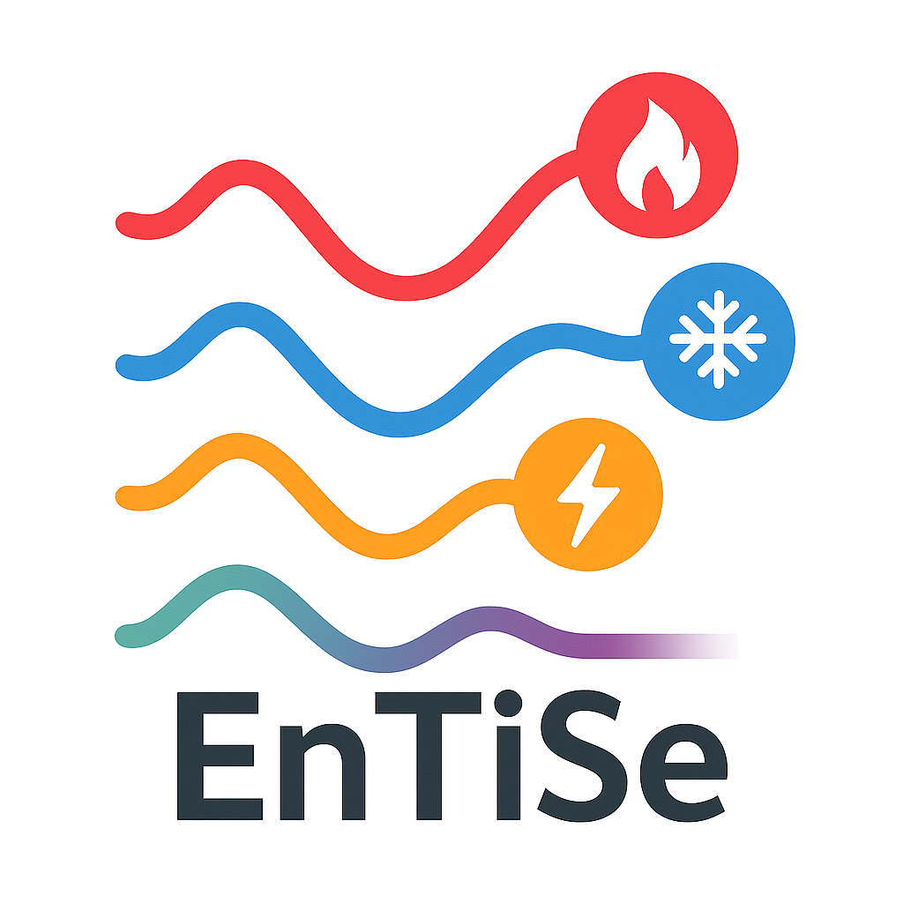

====================
EnTiSe Documentation
====================

**EnTiSe** (Energy Time Series) is a Python framework for generating synthetic time series data for energy systems research.
It provides a flexible and extensible platform for creating realistic time series for:

* **Electricity demand**
* **Domestic hot water (DHW)**
* **Heating demand**
* **Cooling demand**
* **Heat pumps (COP)**
* **HVAC**
* **Occupancy**
* **PV**
* **Wind**

The ``file`` method reads time series of any type from your own tables.

EnTiSe is designed to support a wide range of research applications in the energy domain:

* **Building Energy Modeling**: Simulate thermal behavior and energy consumption of buildings
* **Renewable Energy Integration**: Model the variability of renewable energy sources and their impact on energy systems
* **Demand Response**: Analyze the potential for demand-side management and flexibility
* **Energy System Planning**: Support the design and sizing of energy systems with realistic load profiles

The framework can be integrated with other energy modeling tools and workflows, serving as a foundation for comprehensive energy systems analysis.

Key Features
------------

* **Modular Design**: Easily extensible with new methods and strategies independent of existing methods
* **Flexible Pipeline**: Automatic dependency resolution between methods
* **Multiple Domains**: Support for HVAC, electricity, and more

Quick Start
-----------

Follow :ref:`getting_started` to generate HVAC demand with ``Generator``
or call a PV method directly.

.. toctree::
   :maxdepth: 1
   :caption: Contents:

   installation
   getting_started
   workflow
   migration
   architecture
   methods/index
   services/index
   examples
   api/index

Indices and tables
------------------

* :ref:`genindex`
* :ref:`modindex`
