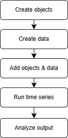

.. _workflow:

Workflow
========

   High-level workflow (see sections below for dependency resolution, decision guide, and troubleshooting).

This section provides an overview of the EnTiSe workflow, detailing the lifecycle of generating timeseries data from object definitions and input data. Follow these steps to seamlessly integrate EnTiSe into your projects.

Overview
--------

EnTiSe processes data in the following stages:

1. **Object Definition**: Define the metadata for the timeseries generation.
2. **Input Data Preparation**: Provide the required timeseries input data.
3. **Dependency Resolution**: Ensure all methods are executed in the correct order.
4. **Timeseries Generation**: Generate timeseries data and compute summary metrics.
5. **Output Collection**: Collect and export results for further analysis.

Detailed Steps
--------------

1. Define Objects
~~~~~~~~~~~~~~~~~

Objects represent the entities for which timeseries data will be generated. Each object should have:

    - A unique identifier (``Objects.ID``).
    - References to the methods and input data required for processing.

In this example we are creating the timeseries for a building's thermal behavior, so we define an object with the necessary metadata for both HVAC and heat pump methods, as well as shared inputs like weather. Each method may require specific parameters (e.g., resistance and capacitance for HVAC, source/sink types for heat pumps) that should be included in the object definition. You can look up the required and optional parameters for each method in the :ref:`methods` section.

Shared inputs (like weather) can be referenced by multiple methods for the same object, allowing for efficient reuse of data across different timeseries types. If you want to tie a specific input to a method, you can use the convention of writing the input key as ``{method}:{input}`` (e.g., ``hvac:weather``) to make it clear which method uses which input.

.. code-block:: python

    objects = [
        {
            "id": "building1",
            # Methods per type for the SAME object
            "hvac": "1R1C",
            "hp": "ruhnau",
            # Shared inputs and parameters
            "weather": "weather",
            # HVAC parameters
            "resistance[K W-1]": 2.0,
            "capacitance[J K-1]": 1e5,
            # Heat pump parameters for Ruhnau (typical defaults shown)
            "hp_source": "air",         # air, soil, water
            "hp_sink": "radiator",      # radiator, floor, water
        }
    ]

2. Prepare Input Data
~~~~~~~~~~~~~~~~~~~~~

Input data provides the raw timeseries required for processing. Ensure your data includes:

    - All required columns specified by the methods.
    - Compatible formats (e.g., ``pandas.DataFrame``).

Example:

.. code-block:: python

    import pandas as pd

    # Minimal weather DataFrame needed by HVAC 1R1C and HP Ruhnau:
    # requires a datetime index/column and outdoor temperature
    idx = pd.date_range("2025-01-01", periods=48, freq="30min", tz="UTC")
    weather_df = pd.DataFrame({
        "datetime": idx,
        "air_temperature[C]": 0.0,
    }, index=idx)

    data = {"weather": weather_df}

3. Add Objects and Input Data
~~~~~~~~~~~~~~~~~~~~~~~~~~~~~

Use the ``Generator`` to add your objects and input data for processing. The generator will handle the orchestration of method execution based on the object definitions and available data. Alternatively, you can run the methods directly (see the “Direct Method Access” section below), but using the generator allows for automatic dependency resolution and batch processing.

.. code-block:: python

    from entise.core.generator import Generator

    # Initialize the generator
    gen = Generator()

    # Add objects
    gen.add_objects(objects)

4. Dependency Resolution
~~~~~~~~~~~~~~~~~~~~~~~~

EnTiSe ensures that methods with dependencies are executed in the correct order. This is handled automatically by the dependency resolver:

- If a configured method requires another timeseries type, EnTiSe computes that dependency first.
- Independent methods for the same object (e.g., HVAC and HP) run side‑by‑side using the shared inputs (like ``weather``).

Please ensure that the methods do not have circular dependencies, as this will cause an error. If you encounter a dependency error, check that all required inputs are provided and that the method configurations are correct.

5. Generate Timeseries
~~~~~~~~~~~~~~~~~~~~~~

Generate timeseries data with the specified number of worker processes. EnTiSe uses joblib for parallel processing, which can significantly speed up generation when you have many objects. For debugging or smaller runs, you can set ``workers=1`` to run sequentially. Please note that some API integreated methods, like pyLPG, may not support parallel execution due to internal state or caching, so check the method documentation if you encounter issues.

.. code-block:: python

    # With multiple workers (parallel processing)
    summary, results = gen.generate(data, workers=4)

    # With a single worker (sequential processing, easier for debugging, faster for small runs)
    summary, results = gen.generate(data, workers=1)

6. Collect and Export Results
~~~~~~~~~~~~~~~~~~~~~~~~~~~~~

Once processing is complete, you can access and export your results. The per‑object results is a dict keyed by object id, and each entry is another dict keyed by timeseries type (e.g., "hvac", "hp").

- **Access Summary Metrics**:

.. code-block:: python

    # Summary KPIs per object (rows indexed by object id)
    print(summary)

- **Access per‑type timeseries for an object**:

.. code-block:: python

    res_obj = results["building1"]
    hvac_ts = res_obj["hvac"]  # indoor temperature, heating/cooling loads
    hp_ts = res_obj["hp"]      # heat pump COP timeseries

- **Export Timeseries**:

.. code-block:: python

    # Export each type separately
    hvac_ts.to_csv("output/building1_hvac.csv")
    hp_ts.to_csv("output/building1_hp.csv")

.. _large_runs:

Large Runs: Chunks and Sinks
----------------------------

``generate`` returns every time series at once. For a large run, for example 10,000 buildings at
15-minute resolution, that may not fit in memory. EnTiSe can compute the objects in chunks instead and
hand you one chunk at a time. Each object is computed exactly as by ``generate``, so the chunk size, the
number of workers and the batch size don't change any value.

- Each chunk holds up to ``chunk_size`` objects (500 by default), in the order they were added.
- An object is never split: all its time series types are in the same chunk.
- ``batch_size`` and ``workers`` apply within each chunk. Each chunk waits for its slowest object before
  the next one starts.
- Object ids must be unique. A repeated id raises a ``ValueError`` before anything is computed.

**Iterate over the chunks** with ``iter_generate``. It takes the same arguments as ``generate``, plus
``chunk_size``:

.. code-block:: python

    summaries = []
    for summary, timeseries in gen.iter_generate(data, chunk_size=200, workers=4):
        for obj_id, by_type in timeseries.items():
            by_type["hvac"].to_csv(f"output/{obj_id}_hvac.csv")
        summaries.append(summary)

    summary = pd.concat(summaries)  # the same summary as generate() returns

**Or pass a sink** to ``generate``. A sink subclasses :class:`~entise.core.storage.TimeseriesStorage` (also importable as
``entise.TimeseriesStorage``) and implements
``setup``, ``write_batch`` and ``finalize``, and optionally ``close``. ``generate(data, storage=sink)``
computes the objects in chunks of ``sink.chunk_size`` and calls:

1. ``sink.setup()`` once, before the first chunk;
2. ``sink.write_batch(timeseries)`` per chunk, with ``{object id: {type: DataFrame}}``;
3. ``sink.finalize()`` once, after the last chunk.

It returns the summary of all objects and an empty dict, because the sink received the time series. If
an object fails with ``raise_on_error=True``, or ``write_batch`` or ``finalize`` raises, the generator
calls ``sink.close()`` instead of ``finalize()`` and re-raises the error. Chunks already written stay
written, so a sink that must be all-or-nothing handles that in ``close``. If ``setup`` itself raises, the
sink is not closed, as with a context manager. An object that fails with ``raise_on_error=False`` reaches
``write_batch`` with an empty dict, and its error is in the summary.

EnTiSe ships no sink. This one writes one CSV file per chunk and time series type:

.. code-block:: python

    from pathlib import Path

    import pandas as pd

    from entise import Generator, TimeseriesStorage

    class CsvChunkSink(TimeseriesStorage):
        """Write each chunk as one CSV file per time series type."""

        chunk_size = 200

        def __init__(self, folder):
            self.folder = Path(folder)
            self.chunks = 0

        def setup(self):
            self.folder.mkdir(parents=True, exist_ok=True)

        def write_batch(self, timeseries):
            self.chunks += 1
            types = sorted({ts_type for by_type in timeseries.values() for ts_type in by_type})
            for ts_type in types:
                frames = {obj_id: by_type[ts_type] for obj_id, by_type in timeseries.items() if ts_type in by_type}
                table = pd.concat(frames, names=["id"])  # one row per object and time step
                table.to_csv(self.folder / f"chunk-{self.chunks:04d}-{ts_type}.csv")

        def finalize(self):
            print(f"Wrote {self.chunks} chunks to {self.folder}")

    summary, _ = gen.generate(data, storage=CsvChunkSink("output/chunks"))

For Parquet, write ``table.to_parquet(...)`` instead of ``table.to_csv(...)``. That needs ``pyarrow``,
which EnTiSe doesn't install.

To drive a sink from your own loop over ``iter_generate``, use it as a context manager. Entering calls
``setup``, and leaving calls ``finalize``, or ``close`` if the block raised:

.. code-block:: python

    with CsvChunkSink("output/chunks") as sink:
        for summary, timeseries in gen.iter_generate(data, chunk_size=sink.chunk_size):
            sink.write_batch(timeseries)

Alternative Workflow: Direct Method Access
------------------------------------------

Call a single method directly for tighter control or easy embedding:

.. code-block:: python

    from entise.methods.pv import PVLib

    pv = PVLib()
    result = pv.generate(
        latitude=48.1,  # latitude[degree]
        longitude=11.6,  # longitude[degree]
        power=5000,  # power[W], rated power of the system
        weather=weather_df,  # DataFrame with solar radiation data
    )

    summary = result["summary"]
    timeseries = result["timeseries"]

Every method takes the same arguments: ``generate(obj=None, data=None, results=None, ts_type=..., **inputs)``.
Use ``PVLib.input_names()`` to discover which names the method accepts. It maps each accepted name
to its full input key. The mapping includes the full key, its Python name without the unit and height
(such as ``power`` for ``power[W]``), and any aliases from earlier releases.

You can pass a dictionary or a pandas Series row as ``obj`` and supply individual inputs as
keywords in the same call. A keyword value overrides both the unprefixed key and the key
prefixed with the active time series type, such as ``pv:power[W]``. A keyword value of ``None``
leaves the object value in place. Pass a table input such as ``weather`` as a DataFrame or as
the name of a table in ``data``. Unknown names and two non-None keyword values for the same
input raise ``TypeError``.

See :ref:`direct_input_names` for a mixed-call example.

See :ref:`getting_started` for the batch counterpart and the :ref:`examples` for full scripts and notebooks.

Decision Guide
--------------

- Batch vs. Direct method:
  - Use batch processing with ``Generator`` when you have many objects, want dependency resolution, and prefer a single call that returns everything reproducibly.
  - Use direct methods (e.g., ``PVLib().generate(...)``) when you focus on one method, need low-level control, or embed EnTiSe in an existing pipeline.
- Strategy selection cues (examples):
  - Solar gains/PV: If you have DNI/DHI/GHI columns, strategies that use them will be selected; with only GHI, EnTiSe may fall back to simpler transposition.
  - Internal gains: Provide an explicit timeseries when available; otherwise rely on built‑in defaults or occupancy-based strategies if configured.
- Workers: Prefer ``workers=1`` for debugging; increase to utilize cores for production runs.

Data Contracts (Schemas)
------------------------

- Time index and alignment: see `Time Contract`_ below.
- Weather data common columns (examples):
  - ``outdoor_temperature[C]``, ``global_horizontal_irradiance[W m-2]``, ``direct_normal_irradiance[W m-2]``, ``diffuse_horizontal_irradiance[W m-2]``, ``wind_speed[m s-1]``, ``relative_humidity[1]``.
  - Column names follow the pattern ``name[unit]`` (optionally with height ``@2m`` etc.).
- Objects (metadata): always include ``id`` and method/strategy selectors per type, e.g. ``{"id": "building1", "hvac": "1R1C", "weather": "weather"}``.
- Method-specific keys (examples):
  - HVAC 1R1C: ``resistance[K W-1]``, ``capacitance[J K-1]``, optional ``power_heating[W]``, ``power_cooling[W]``, temperature setpoints.
  - PV pvlib: ``latitude[degree]``, ``longitude[degree]``, optional ``power[W]``, ``azimuth[degree]``, ``tilt[degree]``.

.. _time-contract:

Time Contract
-------------

.. note::

   This is the time contract of EnTiSe 2.0.0, which every method and the
   Open-Meteo weather service follow. For what changed against earlier
   versions and how to adapt existing inputs, see :doc:`migration`.

- **Timestamps identify instants.** A table carries its timestamps in a
  ``datetime`` column or in its index. Accepted forms are typed datetime
  values and ISO 8601 text, with a UTC offset or ``Z``
  (``2022-07-01 12:00:00+02:00``) or without one. Other text formats and
  numbers raise an error, so convert them with ``pandas.to_datetime`` first. If a table has both a ``datetime`` column and a datetime index, they
  must identify the same instants.
- **Naive timestamps are read as UTC.** EnTiSe logs one warning per table and
  run. If a table holds local times, localize it before passing it:

  .. code-block:: python

      df["datetime"] = df["datetime"].dt.tz_localize("Europe/Berlin", ambiguous="infer")

  ``ambiguous="infer"`` resolves the repeated hour when clocks go back.
- **One axis per run.** Each table is read once per ``Generator.generate``
  call, as a UTC ``DatetimeIndex`` in ``datetime64[us]``, sorted by instant.
  A missing, unreadable or repeated timestamp raises an error that names the
  table and the timestamp. Methods with a fixed time step also require a
  regular step. EnTiSe never changes the frames you pass in.
- **Each label marks the start of its interval.** Interval quantities, such
  as irradiance or power, are means over ``[t, t + step)``. Instantaneous
  quantities, such as air temperature, are values at ``t``. EnTiSe's
  Open-Meteo service returns data labelled this way; data downloaded from
  Open-Meteo directly labels hourly irradiance at the end of the hour. If at
  least 14 days of hourly or
  longer irradiance peak about one step after solar noon, EnTiSe warns and
  suggests shifting those columns one row earlier. The warning appears once
  per run and longitude cell in each worker process.
- **Outputs.** Every time series of an object is indexed by the weather's
  instants in the object's ``timezone``, or in UTC with
  ``Generator.generate(..., utc=True)``. Solar geometry is evaluated at the
  midpoint of each interval. In the RC models, row ``t`` covers
  ``[t, t + step)``: heating and cooling loads are means over that interval,
  ``temperature_in`` is the indoor temperature at ``t`` (row 0 is the
  initial temperature), and the summary demand is the sum of load times step.
- **Site time zone.** The object key ``timezone`` (an IANA name such as
  ``Europe/Berlin``) sets the local calendar of the object: local hour,
  weekday, holidays and daylight saving days. It does not change how tables
  are read. Without it, the calendar is UTC.
- **Auxiliary tables** (internal gains, ventilation, ``file``) align with the
  weather by timestamp. A table without timestamps is used row by row only if
  it has one row per time step, with a warning; any other mismatch raises an
  error. A finer table, such as 15-minute values on hourly weather, is
  averaged over each weather step, with a warning; it must still hold every
  weather instant, so a table shifted against the weather's steps raises. Rows
  outside the weather's span are ignored. These warnings appear once per table
  and run in each worker process. A ``file`` table for an object without a
  ``weather`` key keeps its own timestamps; without timestamps it is returned
  unchanged, with a warning.

Performance and Reproducibility
-------------------------------

- Parallelism: ``Generator.generate(data, workers=N)`` leverages joblib. Use ``workers=-1`` for all cores; use ``1`` for deterministic, easier-to-debug runs.
- Caching: Some methods cache preprocessed inputs (e.g., normalized weather) within a process to reduce overhead across many objects.
- Determinism: Methods that draw random numbers, such as Jordan-Vajen DHW, are reproducible with a seed.

  - ``Generator.generate(data, seed=42)`` sets a run seed. Each object and time series type draws its own stream,
    derived from the run seed, the object's ``id`` and the type. The same seed gives bit-identical time series,
    whatever the order of the objects, the number of workers, the batch size or the process. Objects with
    different ids draw different numbers. The id counts by its text, so ``1`` and ``"1"`` share a stream, while
    ``1.0`` (an id column that pandas read as floats) does not.
  - An object's ``seed`` key (or ``<type>:seed``) takes precedence over the run seed and gives the same result
    with or without one. A direct call such as ``JordanVajen().generate(obj, data, seed=42)`` uses it as the
    object's seed.
  - Without either seed, such methods draw different numbers in every run.
  - PyLPG is not seeded by EnTiSe: pylpg chooses the household members with Python's global random numbers, so
    its profiles can differ between runs even with a seed.

Validation and Troubleshooting
------------------------------

- Missing columns: Errors like “column not found” usually indicate a mismatch between expected names/units and your DataFrame. Check the column naming pattern and method docs.
- Datetime issues: Ensure ``datetime`` can be parsed and identifies each instant once; see `Time Contract`_. Methods with a fixed time step reject irregular steps.
- Dependency errors: If a required dependency is not provided as input data nor producible by a configured strategy, add the missing input or configure the upstream type.
- Quick checks: Start with a single object and ``workers=1``; print the first few rows of inputs; use a shorter time window to iterate faster.
